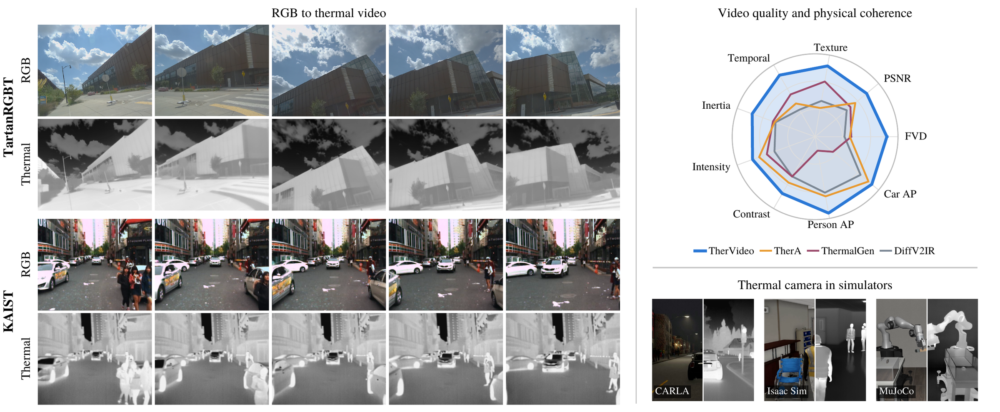

# Weaving Heat from Color: Thermal Video Synthesis with Physical Coherence

**CVPR 2027 Submission** · Anonymous Authors · [Project page](https://thervidanon.github.io/thervideo/)



TherVideo turns RGB video into temporally consistent thermal video. This repository contains the inference code of
the offline model.

## Installation

```bash
conda create -n thervideo python=3.10 -y && conda activate thervideo
pip install torch --index-url https://download.pytorch.org/whl/cu128   # any CUDA build of PyTorch >= 2.4
pip install -r requirements.txt
```

A GPU with at least 40 GB of memory is recommended.

## Weights

1. Base model: download [Wan2.2-TI2V-5B-Diffusers](https://huggingface.co/Wan-AI/Wan2.2-TI2V-5B-Diffusers):

   ```bash
   huggingface-cli download Wan-AI/Wan2.2-TI2V-5B-Diffusers --local-dir checkpoints/Wan2.2-TI2V-5B-Diffusers
   ```

2. TherVideo weights (`thervideo_offline.safetensors`): will be released after the review period. Place the file in
   `checkpoints/`.

## Usage

```bash
python infer.py --input path/to/rgb.mp4 --output thermal.mp4
```

| Option | Default | Description |
|---|---|---|
| `--input` | | RGB video file or a directory of frames |
| `--output` | | output `.mp4` |
| `--sensor` | `radiometric` | thermal style: `radiometric` (fixed per-clip scaling) or `agc8` (8-bit auto-gain) |
| `--steps` | `30` | sampling steps |
| `--guidance` | `2.0` | guidance scale on the RGB condition |
| `--side_by_side` | off | write the RGB input next to the thermal output |

Inputs are resampled to 10 Hz, center-cropped to 5:4 and resized to 640×512. Videos are processed in windows of
33 frames, so the input needs at least 33 frames.

From Python:

```python
from thervideo import TherVideoPipeline
from thervideo.video import read_video, write_video

pipe = TherVideoPipeline.from_pretrained("checkpoints/Wan2.2-TI2V-5B-Diffusers",
                                         "checkpoints/thervideo_offline.safetensors")
rgb = read_video("rgb.mp4")             # uint8 [N, 512, 640, 3]
thermal = pipe(rgb)                     # uint8 [N, 512, 640]
write_video("thermal.mp4", thermal)
```

The streaming model will be released together with its weights.

## License

The code is released under the [Apache 2.0 License](LICENSE). The base model is subject to the
[Wan2.2 license](https://huggingface.co/Wan-AI/Wan2.2-TI2V-5B-Diffusers).
