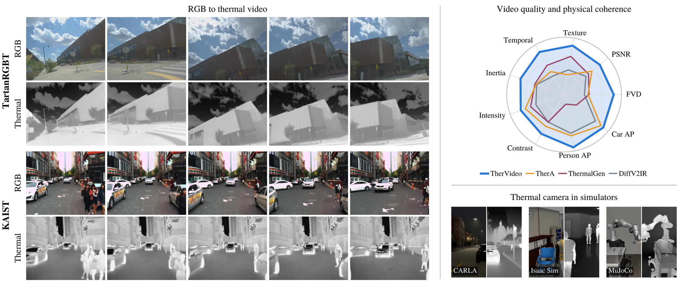

# Weaving Heat from Color: Thermal Video Synthesis with Physical Coherence

**CVPR 2027 Submission** · Anonymous Authors

Project page: https://thervidanon.github.io/thervideo/

**Our proposed method synthesizes temporally consistent thermal observations from RGB.**
Left: RGB-to-thermal video translation on TartanRGBT and KAIST datasets.
Top right: baseline comparisons, with video quality and physical coherence on log-scaled axes.
Bottom right: three real-time simulation examples, with rendered RGB (left half) and generated thermal (right half).

## Abstract

Thermal imaging enables perception under limited illumination, but collecting diverse thermal data and constructing
accurate physical simulators remain costly. Thermal synthesis addresses this data bottleneck by translating abundant RGB
observations into thermal observations, yet existing frame-wise translation methods often introduce temporal flicker and
physically unsupported appearance. To this effect, we present **TherVideo**, a framework that jointly models thermal
appearance across time using a video foundation model. Progressive cross-modal adaptation unifies joint RGB–thermal
generation and bidirectional translation to learn shared scene dynamics and modality-specific thermal appearance.
Reinforcement learning via reward-weighted flow matching improves physical coherence by promoting desired thermal
behavior and suppressing unsupported texture and illumination responses. Causal autoregression, few-step distribution
matching distillation, and bounded-context rollout training enable low-latency streaming while maintaining long-horizon
coherence. TherVideo reduces FVD by 37.2% and 54.2% on TartanRGBT and KAIST datasets, respectively, compared with the
strongest adapted baseline on each dataset. For real-time sensor simulation, TherVideo achieves 17.6 FPS end-to-end at
640×512 on a single RTX 5090.

---
Anonymous project page for double-blind review.
